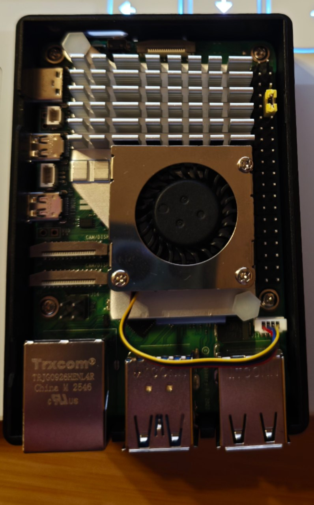
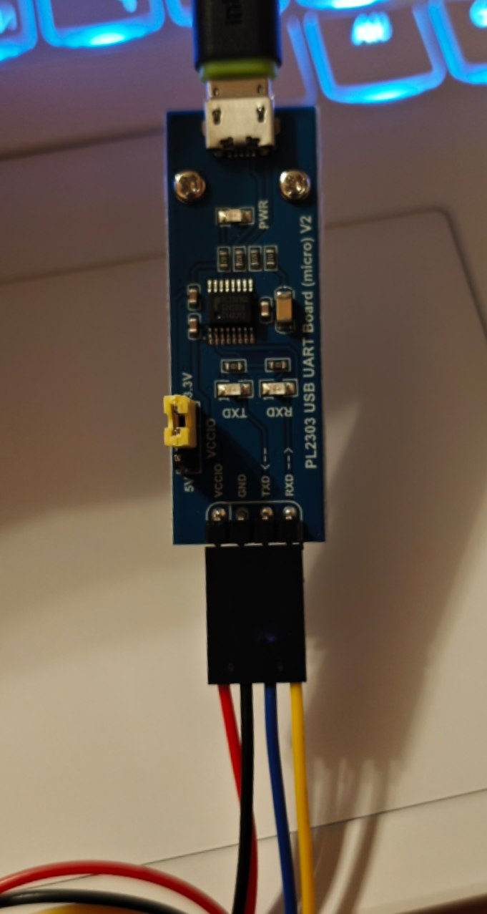
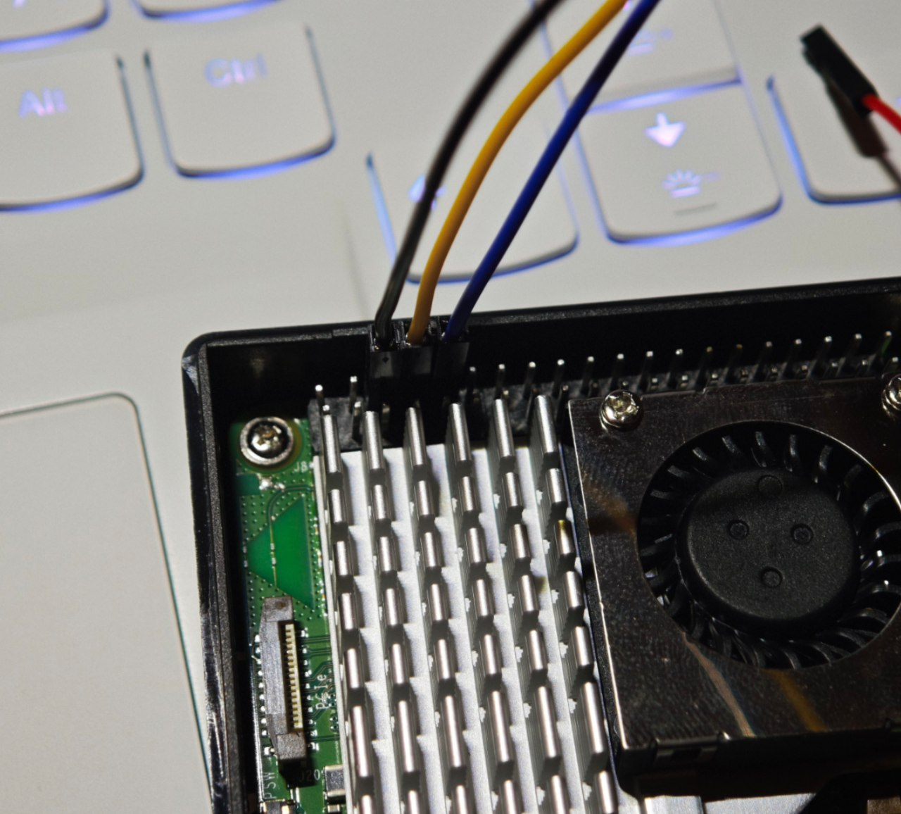

# Report: UART ECHO Application

## 1. Host and Target Preparation for UART Communication

### 1.1. Host Development Tools

| Tool | Version |
|---|---|
| Native GCC | 16.2.1 |
| GNU Make | 4.4.1 |
| AArch64 cross-compiler | GCC 16.1.0 |
| clang-format | 23.1.1 |

### 1.2. Target Platform Identification

The TARGET is a Raspberry Pi 5 with 1 GB of RAM running
Raspberry Pi OS Lite.

The operating system and architecture specs of Target environment:

| Parameter | Value |
|---|---|
| Hostname | `ajax-rpi5` |
| User | `art207-rpi5` |
| Kernel release | `6.18.50+rpt-rpi-2712` |
| Machine architecture | `aarch64` |
| Userspace word size | 64 bits |
| Debian package architecture | `arm64` |
| Operating system base | Debian GNU/Linux 13, Trixie |
| Reported Debian full version | 13.7 |

The TARGET therefore uses a 64-bit ARM Linux environment.

### 1.3. UART Configuration

The boot configuration was opened on the TARGET using:

```bash
sudo nano /boot/firmware/config.txt
```

The Raspberry Pi 5 configuration section contains:

```ini
[pi5]
dtoverlay=nospi10
dtoverlay=uart0-pi5

[all]
```

The `uart0-pi5` overlay enables UART0 on GPIO14 and GPIO15.
The existing `nospi10` setting was retained.

The UART connections on the 40-pin header are:

| Signal | GPIO | Physical header pin |
|---|---|---|
| TXD0 - transmit | GPIO14 | 8 |
| RXD0 - receive | GPIO15 | 10 |



### 1.4. Kernel Console Inspection

The active kernel command line was inspected using:

```bash
cat /proc/cmdline
```

The relevant console parameters were:

```text
console=ttyAMA10,115200 console=tty1
```

The serial kernel console is assigned to `/dev/ttyAMA10`, the Raspberry
Pi 5 debug UART.

The application uses `/dev/ttyAMA0` on GPIO14 and GPIO15. Therefore,
the observed `console=ttyAMA10,115200` parameter doesn't assign the
application's UART0 port to the kernel console, and removing this
parameter wasn't required.

### 1.5. Device, Pin Function, and Permission Checks

The UART device, GPIO functions, and user groups were checked using:

```bash
ls -l /dev/ttyAMA0
pinctrl get 14
pinctrl get 15
id
```

Device information:

```text
crw-rw---- 1 root dialout 204, 64 Oct 15 22:07 /dev/ttyAMA0
```

This confirms that `/dev/ttyAMA0` exists as a character device.
Its owner is `root`, and its group is `dialout`.
Both the owner and group have read and write permissions.

GPIO configuration:

```text
14: a4    pn | hi // GPIO14 = TXD0
15: a4    pu | hi // GPIO15 = RXD0
```

The output confirms that GPIO14 is assigned to UART0 transmission
and GPIO15 is assigned to UART0 reception.

The `id` output confirmed that user `art207-rpi5`, UID 1000,
belongs to the `dialout` group.

Effective read and write access was checked explicitly:

```bash
test -r /dev/ttyAMA0 && test -w /dev/ttyAMA0 && echo "UART access: OK"
```

Result:

```text
UART access: OK
```

The user can therefore access the UART device without running the
communication application as root.

### 1.6. Port Availability Check

The serial login service and processes using the UART device were
checked using:

```bash
systemctl is-active serial-getty@ttyAMA0.service
sudo fuser -v /dev/ttyAMA0
```

The service state was:

```text
inactive
```

The `fuser` command produced no process listing.

At the time of inspection, the serial login service was inactive
and no process holding `/dev/ttyAMA0` open was reported.

## 2. UART Loopback Test

### 2.1. Test Arrangement

UART0 was tested by connecting its transmit and receive pins directly:

```text
Raspberry Pi 5, 40-pin header

Physical pin 8                         Physical pin 10
GPIO14 / TXD0 ─────── jumper ────────── GPIO15 / RXD0
```


The transmitted bytes return to the receiver of the same UART.

The terminal program runs on the TARGET and opens `/dev/ttyAMA0`.

### 2.2. Terminal Configuration

The following command was executed on the TARGET:

```bash
picocom --baud 115200 --databits 8 --parity n \
    --stopbits 1 --flow n --omap crcrlf /dev/ttyAMA0
```

Relevant startup output:

```text
art207-rpi5@ajax-rpi5:~ $ picocom --baud 115200 --databits 8 --parity n \
    --stopbits 1 --flow n --omap crcrlf /dev/ttyAMA0
picocom v3.1

port is        : /dev/ttyAMA0
flowcontrol    : none
baudrate is    : 115200
parity is      : none
databits are   : 8
stopbits are   : 1
escape is      : C-a
local echo is  : no
noinit is      : no
noreset is     : no
hangup is      : no
nolock is      : no
send_cmd is    : sz -vv
receive_cmd is : rz -vv -E
imap is        :
omap is        : crcrlf,
emap is        : crcrlf,delbs,
logfile is     : none
initstring     : none
exit_after is  : not set
exit is        : no

Type [C-a] [C-h] to see available commands
Terminal ready
Loopback123
```

Disabling local echo is essential for this test. It prevents
`picocom` from displaying keyboard input directly, allowing the
displayed text to demonstrate that bytes were received back
through the serial port.

### 2.3. Observed Result

The following test string was entered:

```text
Loopback123
```

The recorded terminal output was:

```text
Type [C-a] [C-h] to see available commands
Terminal ready
Loopback123
```

The transmitted string was displayed with local echo disabled,
which is consistent with the bytes returning through the TX–RX
jumper.

The data path was:

```text
Keyboard → picocom → UART TX → jumper → UART RX → picocom → terminal
```

### 2.4. Test Outcome and Scope

The loopback test passed for the transmitted string `Loopback123`
with the UART configured for 115200 8N1.

The recorded checks confirm:

- availability of `/dev/ttyAMA0`;
- UART0 pin assignment on GPIO14 and GPIO15;
- read and write access for the regular user;
- inactive serial login service on UART0;
- successful transmission and reception through the loopback connection.

A control test with the jumper removed with local echo disabled and no
external device returning data, the expected result is that typed
characters aren't displayed.

## 3. Implemented Application Functionality (Commit: Task-05: add UART echo application with logging and signal handling; and add Report.md)

### 3.1. Port Selection and Configuration

The device path is passed as a command-line argument:

```bash
./mycom /dev/ttyAMA0
```

If the number of arguments is incorrect, the application displays a usage message and exits with code `1`.

The port is opened for reading and writing using the following flags:

- `O_RDWR` - enables bidirectional communication;
- `O_NOCTTY` - prevents the port from becoming the controlling terminal of the process;
- `O_NONBLOCK` - enables non-blocking operations on the device.

The original port settings are saved using `tcgetattr()`.

The following parameters are configured using `termios`:

| Parameter | Value |
|---|---|
| Receive and transmit baud rate | 115200 bps |
| Data bits | 8 |
| Parity | Disabled |
| Stop bits | 1 |
| Hardware flow control | Disabled |
| Software flow control | Disabled |
| Data processing mode | Raw mode |

Raw mode disables terminal echo and automatic character processing. This allows the application to determine message boundaries independently.

### 3.2. Message Reception and Response Generation

The application uses `poll()` to check whether the port is ready for reading. Received bytes are accumulated sequentially in a buffer.

A message is considered complete only after receiving the following two bytes:

- `\r` - CR, Carriage Return;
- `\n` - LF, Line Feed.

An individual CR or LF does not terminate a message.

After receiving a complete message, the application:

1. Writes the original message content to the log file.
2. Converts `a–z` to `A–Z` and `A–Z` to `a–z`.
3. Sends the converted message through UART, followed by CRLF.
4. Resets the buffer length counter to prepare for the next message.

Example:

```text
Received: Hello UART 123!\r\n
Sent:     hELLO uart 123!\r\n
```

The `write_all()` function is used for transmission. It handles partial writes, since a single `write()` call may write only part of the data.

### 3.3. Logging

The log file is opened before the UART device. This makes it possible to record an error if the device does not exist or the user lacks the required access permissions.

The log filename follows this format:

```text
logs/YYYYMMDD-HHMMSS-PID.log
```

The timestamp represents the application start time, while PID is the process identifier.

The `"wx"` file opening mode prevents an existing file from being overwritten.

Each log entry begins with the local date, time, and time zone offset.

The following log entry types are supported:

| Type | Description |
|---|---|
| `START` | Successful port opening and configuration |
| `RX` | Complete message received |
| `ERROR` | Runtime error |
| `STOP` | Termination caused by SIGINT or SIGTERM |

An `RX` entry contains the original message content before case conversion, excluding the terminating CRLF.

Control bytes, bytes outside the printable ASCII range, and backslash characters are represented using the `\xNN` notation. This ensures that each received message occupies a single line in the log file.

After each log entry, `fflush()` is called.

If the log file cannot be created or written to, the corresponding error message is printed to the standard error stream (`stderr`).

### 3.4. Error and Signal Handling

The application checks the results of device opening, `termios` configuration, event polling, reading, writing, and logging operations.

Errors are reported through `stderr` and recorded in the log file whenever logging is available.

If an error occurs, the application exits with code `1`.

Handlers for `SIGINT` and `SIGTERM` are installed using `sigaction()`.

The signal handler only stores the received signal number in a variable of type `volatile sig_atomic_t`.

The main application logic detects the termination request, records the reason for stopping, restores the original port settings, and closes all opened resources.

When the application terminates successfully in response to a signal, it returns exit code `0`.

### 3.5. Limitations of the Current Implementation

- The maximum message content length is 1024 bytes, excluding CRLF.
- The buffer size is 1026 bytes, including the terminating sequence.
- Exceeding the maximum allowed message length causes an error and terminates the application.
- Case conversion is supported only for English ASCII letters.
- All other bytes are transmitted unchanged; Unicode case conversion is not supported.
- An incomplete message is discarded when the application terminates.
- The reception timestamp is recorded when the application recognizes a complete message, rather than at the hardware level when the first bit arrives.
- Disconnecting the TX/RX wires does not necessarily cause a device error; no separate communication link monitoring protocol is implemented.

### 3.6. Compilation Verification

Syntax checking and compiler diagnostics were performed using the following command:

```bash
gcc -std=c11 -Wall -Wextra -Wpedantic -Werror \
    -fsyntax-only src/mycom.c
```

**Result:** Exit code `0`, with no compiler diagnostic messages.

A complete native build was also performed in a temporary directory using the following compiler flags:

```text
-std=c11 -O2 -Wall -Wextra -Wpedantic -Werror
```

Compilation and linking completed successfully without warnings.

## 4. Makefile Development and Verification

### 4.1. Build Automation

A Makefile was added to automate compilation, cleanup, and deployment
of the UART ECHO application.

The application is built directly from `src/mycom.c` into the
`mycom` executable. Since the project currently contains one C source
file, separate object-file rules aren't required.

The Makefile provides the following targets:

| Target | Purpose |
|---|---|
| `all` | Build the `mycom` executable |
| `clean` | Remove the generated executable |
| `deploy` | Build the executable if necessary and copy it to the TARGET |

The `all` target is the default target, so running `make` builds
the application.

The `all`, `clean`, and `deploy` targets are declared as `.PHONY`.
Recipe commands use Tab indentation.

### 4.2. Compiler Configuration and Cross-Compilation

The compiler is selected using:

```makefile
CROSS_COMPILE ?=
CC = $(CROSS_COMPILE)gcc
```

With an empty `CROSS_COMPILE` value, the Makefile invokes the native
`gcc` compiler.

For the ARM64 TARGET, the prefix is supplied as a command-line argument:

```bash
make all CROSS_COMPILE=aarch64-linux-gnu-
```

This selects `aarch64-linux-gnu-gcc`.

The default compiler flags are:

```text
-std=c11 -O2 -Wall -Wextra -Wpedantic
```

These select the C11 language standard, enable optimization,
and enable compiler diagnostics.

The Makefile also accepts `CPPFLAGS`, `CFLAGS`, `LDFLAGS`, and `LDLIBS`,
allowing build options to be supplied without editing the file.

For the verified static ARM64 build, the following command was used:

```bash
make all CROSS_COMPILE=aarch64-linux-gnu- LDFLAGS=-static
```

The `-static` linker option produces a statically linked executable.

### 4.3. Native and ARM64 Build Verification

Build checks were performed on the HOST using copies of the current
Makefile and source file in a temporary directory outside the repository.

The following sequence was executed:

```bash
make all
file mycom
make clean

make all CROSS_COMPILE=aarch64-linux-gnu- LDFLAGS=-static
file mycom
make clean
```

Results:

| Check | Result |
|---|---|
| Native build | Exit code `0`, no compiler diagnostics |
| Native executable inspection | ELF 64-bit, x86-64, dynamically linked |
| Cleanup after native build | Exit code `0` |
| Static ARM64 build | Exit code `0`, no compiler diagnostics |
| ARM64 executable inspection | ELF 64-bit, ARM aarch64, statically linked |
| Cleanup after ARM64 build | Exit code `0`; executable no longer present |

These checks confirm successful compilation and linking for both
architectures.

### 4.4. Deployment Target

The deployment destination is configured through:

```makefile
REMOTE ?= art207-rpi5@ajax-rpi5
REMOTE_DIR ?= /home/art207-rpi5/Projects/TASK-05_UART_communication
```

The `deploy` target depends on the executable and performs two operations:

1. Creates the destination directory and its `logs` subdirectory using SSH.
2. Copies `mycom` to the TARGET using SCP.

The generated commands were inspected using a dry run:

```bash
make -n deploy CROSS_COMPILE=aarch64-linux-gnu- LDFLAGS=-static
```

The dry run completed successfully. It verified command generation
without opening an SSH connection or transferring files.

The `deploy` target copies the executable but doesn't start the
application.

### 4.5. Rebuilding When Build Options Change

The Makefile tracks file timestamps, but it doesn't automatically
detect changes to command-line variable values such as `CROSS_COMPILE`
or `LDFLAGS`.

Therefore, a previously built executable must be removed before
switching between native and cross-compilation or changing linker options:

```bash
make clean
make all CROSS_COMPILE=aarch64-linux-gnu- LDFLAGS=-static
```

This prevents a native executable from being reused accidentally
when preparing an ARM64 deployment.

## 5. Deployment and UART ECHO Verification on the TARGET

### 5.1. Hardware Connection

The HOST communicates with the Raspberry Pi through a USB–UART adapter.

The serial interfaces used during the test were:

| Device | Serial interface |
|---|---|
| HOST: USB–UART adapter | `/dev/ttyUSB0` |
| TARGET: Raspberry Pi 5 UART0 | `/dev/ttyAMA0` |

The communication connection uses crossed transmit and receive signals
and a common ground:

| USB–UART adapter | Raspberry Pi 5 |
|---|---|
| TX | GPIO15 / RXD0, physical pin 10 |
| RX | GPIO14 / TXD0, physical pin 8 |
| GND | GND |

The Raspberry Pi UART requires 3.3 V logic levels.

> **Photo 1 - USB–UART adapter pinout:**



> **Photo 2 - USB–UART adapter connected to Raspberry Pi 5:**



### 5.2. Deployed Executable Verification

The application was deployed to the following directory on the TARGET:

```text
/home/art207-rpi5/Projects/TASK-05_UART_communication
```

The following command was executed on the HOST:
```text
make deploy CROSS_COMPILE=aarch64-linux-gnu- LDFLAGS=-static
```

Output:
```text
aarch64-linux-gnu-gcc  -std=c11 -O2 -Wall -Wextra -Wpedantic src/mycom.c -o mycom -static
ssh art207-rpi5@ajax-rpi5 'mkdir -p "/home/art207-rpi5/Projects/TASK-05_UART_communication/logs"'
Enter passphrase for key '/home/art207/.ssh/id_ed25519_rpi':
scp mycom art207-rpi5@ajax-rpi5:/home/art207-rpi5/Projects/TASK-05_UART_communication/mycom
Enter passphrase for key '/home/art207/.ssh/id_ed25519_rpi':
mycom
```

The deployed files were inspected using:

```bash
cd Projects/TASK-05_UART_communication/
ls -a
```

Recorded output:

```text
.  ..  cmdline.txt.before-uart  config.txt.before-uart  logs  mycom
```

Execution permission was set, and the executable format was checked:

```bash
chmod +x mycom
file mycom
```

Recorded output:

```text
mycom: ELF 64-bit LSB executable, ARM aarch64, version 1 (GNU/Linux), statically linked, BuildID[sha1]=ee6b6dc5cccf9d54cde4615fc8434c7f5416e185, for GNU/Linux 3.7.0, with debug_info, not stripped
```

The result identifies the deployed file as a statically linked,
64-bit ARM AArch64 executable.

### 5.3. Application Startup on the TARGET

The application was started from its deployment directory:

```bash
./mycom /dev/ttyAMA0
```

Recorded output:

```text
Ready: /dev/ttyAMA0, 115200 8N1; log: logs/20261016-000646-1235.log
```

The application successfully opened and configured `/dev/ttyAMA0`
and created a log file for this execution.

The filename contains the startup timestamp and process identifier:

- startup timestamp: `20261016-000646`;
- PID: `1235`.

### 5.4. HOST Terminal Configuration

The USB–UART adapter was opened on the HOST using:

```bash
picocom --baud 115200 --databits 8 --parity n \
    --stopbits 1 --flow n --omap crcrlf /dev/ttyUSB0
```

Relevant startup output:

```text
picocom v3.1

port is        : /dev/ttyUSB0
flowcontrol    : none
baudrate is    : 115200
parity is      : none
databits are   : 8
stopbits are   : 1
local echo is  : no
omap is        : crcrlf,
```

Both ends of the connection were configured for 115200 8N1,
with flow control disabled.

Local echo was disabled on the HOST. Therefore, the displayed response
was received through the serial port rather than generated by local
keyboard echo.

The `--omap crcrlf` option converts an outgoing carriage return
into CRLF, providing the message terminator expected by `mycom`.

### 5.5. Message Exchange Result

The following message was entered on the HOST and submitted with Enter:

```text
Hello uart test
```

The response displayed by `picocom` was:

```text
Type [C-a] [C-h] to see available commands
Terminal ready
hELLO UART TEST
```

Comparison:

| Direction | Message content |
|---|---|
| HOST → TARGET | `Hello uart test` |
| TARGET → HOST | `hELLO UART TEST` |

The uppercase `H` was converted to lowercase, and the lowercase
letters were converted to uppercase. Spaces were preserved.

The displayed response matches the expected case-inversion behavior
for the transmitted message.

### 5.6. Termination Using Ctrl+C

The application was stopped by pressing `Ctrl+C` in the TARGET
terminal where `mycom` was running in the foreground.

This delivered `SIGINT` to the application.

After the process terminated, its exit status was checked:

```bash
echo $?
```

Recorded output:

```text
0
```

The application returned a successful exit status. Its log also
recorded `STOP SIGINT`, confirming that the termination signal
was handled by the application.

### 5.7. Log File Verification

After termination, the log directory was inspected on the TARGET:

```bash
cd logs/
ls -a
```

Recorded output:

```text
.  ..  20261015-235003-1230.log  20261016-000646-1235.log
```

The log corresponding to the tested execution was opened using:

```bash
cat 20261016-000646-1235.log
```

Recorded contents:

```text
2026-10-16 00:06:46+0300 START /dev/ttyAMA0
2026-10-16 00:07:13+0300 RX Hello uart test
2026-10-16 00:10:03+0300 STOP SIGINT
```

The log confirms:

- successful startup using `/dev/ttyAMA0`;
- reception of the original message `Hello uart test`;
- a timestamp at the beginning of each entry;
- termination through `SIGINT`.

The `RX` record preserves the received message before case conversion.
The HOST received the converted response `hELLO UART TEST`.

## 6. Automatic Startup Using systemd

### 6.1. Service Configuration

The `systemd/uart-echo.service` file was added to run the UART ECHO
application automatically when the TARGET boots:

```ini
[Unit]
Description=UART Echo application on GPIO14/15

[Service]
Type=simple
User=art207-rpi5
SupplementaryGroups=dialout
WorkingDirectory=/home/art207-rpi5/Projects/TASK-05_UART_communication
ExecStart=/home/art207-rpi5/Projects/TASK-05_UART_communication/mycom /dev/ttyAMA0
Restart=on-failure
RestartSec=3
TimeoutStopSec=5

[Install]
WantedBy=multi-user.target
```

The application runs as `art207-rpi5`, with membership in the `dialout`
group providing access to the UART device. The working directory matches
the deployment directory, so application logs are stored in its `logs/`
subdirectory.

The service is configured to restart after a failure, with a three-second
delay between attempts. Automatic recovery after a failure wasn't tested
during this stage.

### 6.2. Service Deployment and Installation

The service file was copied from the HOST to the TARGET:

```bash
scp ~/Projects/TASK-05.-UART-communication/systemd/uart-echo.service \
    art207-rpi5@ajax-rpi5:~/Projects/TASK-05_UART_communication
```

SCP reported a completed transfer (`100%`).

On the TARGET, the file was installed into the system service directory:

```bash
sudo install -m 644 \
    ~/Projects/TASK-05_UART_communication/uart-echo.service \
    /etc/systemd/system/uart-echo.service
```

The installed unit was checked using:

```bash
sudo systemd-analyze verify /etc/systemd/system/uart-echo.service
```

The command produced no diagnostic messages.

The systemd configuration was then reloaded, and the service was enabled
for automatic startup and started immediately:

```bash
sudo systemctl daemon-reload
sudo systemctl enable --now uart-echo.service
```

Recorded output:

```text
Created symlink '/etc/systemd/system/multi-user.target.wants/uart-echo.service' → '/etc/systemd/system/uart-echo.service'.
```

### 6.3. Initial Service Startup

The service state was inspected using:

```bash
systemctl is-enabled uart-echo.service
systemctl is-active uart-echo.service
systemctl status uart-echo.service --no-pager
```

The first two commands returned:

```text
enabled
active
```

The status output identified the running process as PID `1419`:

```text
/home/art207-rpi5/Projects/TASK-05_UART_communication/mycom /dev/ttyAMA0
```

The journal contained the following startup messages:

```text
Oct 16 01:09:21 ajax-rpi5 systemd[1]: Started uart-echo.service - UART Echo application on GPIO14/15.
Oct 16 01:09:21 ajax-rpi5 mycom[1419]: Ready: /dev/ttyAMA0, 115200 8N1; log: logs/20261016-010921-1419.log
```

This confirmed that systemd started the application using the intended
UART device and working directory.

### 6.4. Automatic Startup After Reboot

The TARGET was rebooted:

```bash
sudo reboot
```

After reconnecting through SSH, the service state and the journal from
the current boot were inspected:

```bash
systemctl is-active uart-echo.service
journalctl -u uart-echo.service -b --no-pager
```

Recorded output:

```text
active
Oct 16 01:12:30 ajax-rpi5 systemd[1]: Started uart-echo.service - UART Echo application on GPIO14/15.
Oct 16 01:12:30 ajax-rpi5 mycom[611]: Ready: /dev/ttyAMA0, 115200 8N1; log: logs/20261016-011230-611.log
```

The application started automatically after reboot, without a manual
`./mycom` invocation. The new process had PID `611` and created a separate
log file for this execution.

### 6.5. UART ECHO Verification After Reboot

On the HOST, the USB-to-UART adapter was opened using:

```bash
picocom --baud 115200 --databits 8 --parity n \
    --stopbits 1 --flow n --omap crcrlf /dev/ttyUSB0
```

Local echo was disabled. The outgoing mapping converted Enter into the
CRLF line terminator required by the application.

The recorded exchange was:

| Direction | Message |
| --- | --- |
| HOST → TARGET, recorded in the application log | `hELLO AFTER REBOOT` |
| TARGET → HOST, displayed by picocom | `Hello after reboot` |

The HOST terminal displayed:

```text
Terminal ready
Hello after reboot
```

On the TARGET, the log was inspected using:

```bash
cd ~/Projects/TASK-05_UART_communication/logs
cat 20261016-011230-611.log
```

Recorded contents:

```text
2026-10-16 01:12:30+0300 START /dev/ttyAMA0
2026-10-16 01:14:04+0300 RX hELLO AFTER REBOOT
```

The received message was preserved in the log before case conversion.
The response displayed on the HOST confirmed that UART communication
and case conversion worked while the application was running as a
systemd service after reboot.

### 6.6. Service Shutdown

The service was stopped on the TARGET:

```bash
sudo systemctl stop uart-echo.service
```

The application log was inspected again:

```bash
cat 20261016-011230-611.log
```

Recorded contents:

```text
2026-10-16 01:12:30+0300 START /dev/ttyAMA0
2026-10-16 01:14:04+0300 RX hELLO AFTER REBOOT
2026-10-16 01:15:51+0300 STOP SIGTERM
```

The `STOP SIGTERM` entry confirms that the application received and
handled the termination signal during service shutdown.

### 6.7. Verification Outcome

The recorded results confirm:

- installation of the systemd service;
- unit verification without diagnostic messages;
- successful startup under systemd;
- automatic startup after a TARGET reboot;
- UART message exchange and case conversion after reboot;
- timestamped logging of the original received message;
- handling of SIGTERM during service shutdown.
